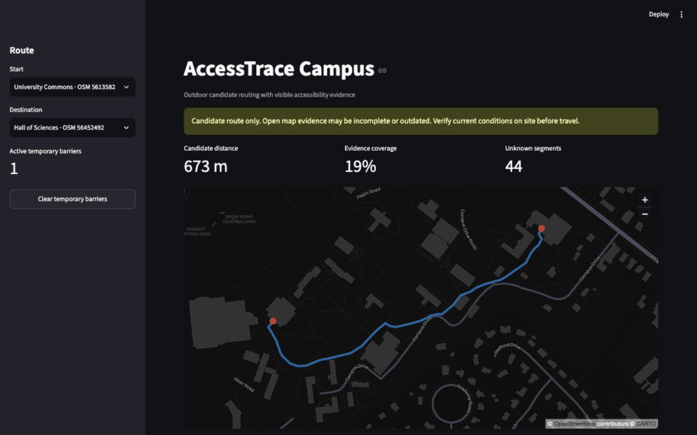

# AccessTrace Campus

AccessTrace Campus is an evidence-first outdoor campus route prototype for people with reduced mobility. It proposes a route, shows which accessibility tags support it, identifies unknown segments, and recalculates when a temporary barrier is reported.

The first prototype is limited to Drew University's outdoor pedestrian network. It uses public OpenStreetMap data and does **not** certify that a route is accessible, safe, current, or field-verified.



## Status

Functional MVP for the STEMergent Hacks 2026 Hackathon Pathway.

## What it demonstrates

- Select two named campus places and calculate a deterministic outdoor candidate route.
- Exclude explicit barriers such as `wheelchair=no`, raised kerbs, and steps without a designated wheelchair ramp.
- Inspect route-level evidence coverage and each segment's known or unknown accessibility tags.
- Add a session-only temporary barrier with an expiry time and recalculate the route.

The route engine uses a bounded OpenStreetMap XML extract, standard-library parsing, and Dijkstra's shortest-path algorithm. Buildings are connected to the nearest mapped pedestrian-network node; this is not a verified accessible entrance.

## Run locally

```bash
python3 -m venv .venv
source .venv/bin/activate
python -m pip install -e .
python scripts/download_osm.py
streamlit run app.py
```

The app opens at `http://localhost:8501` by default.

## Test

```bash
python -m pip install -e '.[dev]'
python -m coverage run --branch -m unittest discover -s tests
python -m coverage report -m
```

The current suite covers routing rules, OSM parsing, temporary-barrier expiry, and the Streamlit user flow.

## Data and attribution

The download script requests a fixed bounding box around Drew University from the official OpenStreetMap API. Raw OSM data is written to `data/raw/` and excluded from Git. OpenStreetMap data is available under the [ODbL](https://www.openstreetmap.org/copyright); the app displays attribution on the map and in its footer.

## Responsible-use boundary

- Candidate routes require human and on-site verification.
- Missing map data is displayed as unknown, never treated as accessible.
- Temporary reports expire and are not written back to OpenStreetMap.
- Indoor navigation and emergency routing are outside the MVP.
- A reported barrier can leave no candidate route when the mapped network has no alternative exit.

The complete Chinese design is in [设计文档.md](设计文档.md).

## Project documents

- [Watch the 1:45 demo video](demo/AccessTrace-Campus-Demo.mp4)
- [Third-party notices](THIRD_PARTY_NOTICES.md)
- [Demo script](demo/demo_script.md)
- [Desktop screenshot](docs/screenshots/access-trace-desktop.jpg)
- [Temporary-barrier reroute](docs/screenshots/access-trace-reroute.jpg)
- [Mobile screenshot](docs/screenshots/access-trace-mobile.jpg)
- [Chinese implementation plan](PLAN.md)
